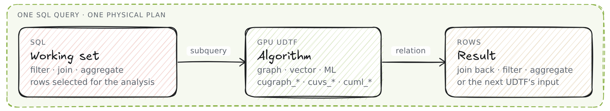
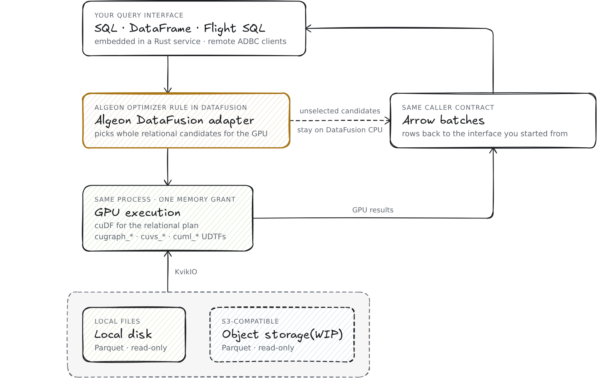

<p align="center">
  
  <br>
  <em>Compose GPU algorithms with SQL.</em><br><br>
  <a href="https://algeon.dev">Website</a> |
  <a href="https://algeon.dev/build">Build</a> |
  <a href="https://docs.rs/algeon-datafusion">API Docs</a>
</p>

---

Algeon (`/ˈæl.dʒi.ən/`, "AL-jee-on") is a GPU query engine built on
[Apache DataFusion](https://datafusion.apache.org/) that enables AI agents,
analysts, and data platforms to investigate warehouse data through SQL. It exposes
NVIDIA's [cuGraph](https://docs.rapids.ai/api/cugraph/stable/),
[cuVS](https://docs.rapids.ai/api/cuvs/stable/), and
[cuML](https://docs.rapids.ai/api/cuml/stable/) libraries as SQL table
functions and executes supported relational operations on
[cuDF](https://docs.rapids.ai/api/cudf/stable/). A table function takes
ordinary subqueries as its relation arguments and returns rows that the same
statement can join, filter, aggregate, or pipe into the next algorithm stage.
Applications embed Algeon as a Rust library in a DataFusion session or connect
through Arrow Flight SQL.

<p align="center">
  <picture>
    <source media="(prefers-color-scheme: dark)" srcset="website/static/img/intro-flow-dark.png">
    
  </picture>
</p>

## A GPU algorithm in SQL

Find the foundational papers BERT relies on without citing them directly:

```sql
CREATE OR REPLACE VIEW bert_seed AS
SELECT paper_id AS vertex, CAST(1.0 AS DOUBLE) AS value
FROM papers
WHERE title = 'BERT: Pre-training of Deep Bidirectional Transformers for Language Understanding'
  AND year = 2018;

SELECT p.year, p.title, ROUND(r.value, 6) AS ppr
FROM cugraph_personalized_pagerank(
  edges => (SELECT src, dst FROM citation_edges),
  personalization => (SELECT vertex, value FROM bert_seed)) r
JOIN papers p ON p.paper_id = r.vertex
WHERE NOT EXISTS (SELECT 1 FROM bert_seed s WHERE s.vertex = r.vertex)
  AND NOT EXISTS (SELECT 1 FROM citation_edges e JOIN bert_seed s ON s.vertex = e.src
                  WHERE e.dst = r.vertex)
ORDER BY r.value DESC
LIMIT 5;
```

| year | title | ppr |
|---|---|---|
| 1983 | A Maximum Likelihood Approach to Continuous Speech Recognition | 0.003127 |
| 2003 | A neural probabilistic language model | 0.002984 |
| 1997 | Long short-term memory | 0.002392 |
| 2014 | Adam: A Method for Stochastic Optimization | 0.002358 |
| 1990 | A statistical approach to machine translation | 0.002344 |

The graph algorithm executes as a table function. Its edge list and seed are
subqueries, and its output joins with `papers` to retrieve titles, satisfies
the two `NOT EXISTS` filters, and sorts like any other relation. The 45.6 million
citation edges are read into GPU memory for this statement and released when
it finishes.

Queries can also chain multiple algorithm families in a single physical plan
without intermediate host copies. For example, an audience campaign analysis
over the [MerRec dataset](https://algeon.dev/guides/datasets/merrec#audience-funnel)
computes seed affinity with `cugraph_personalized_pagerank`, identifies
taste lookalikes with `cuvs_brute_force_knn`, scores candidate shoppers with a
pretrained forest model through `cuml_forest_predict`, and aggregates conversion
with standard SQL. Intermediate relations remain resident in GPU memory throughout
execution. [Explore the examples](https://algeon.dev/guides/datasets).

## Motivation: from warehouse to working set

An analytical question often concerns one tenant, one quarter, or one cohort.
SQL narrows the data lakehouse to the rows that matter. When that working
set and intermediate algorithm state fit in GPU memory, subsequent questions can
extend beyond joins and aggregations: identifying clusters, retrieving nearest
neighbors in embedding space, or scoring candidate rows with a machine learning
model.

Executing these algorithms on warehouse data traditionally requires an external
detour: exporting rows to cloud storage, loading them into a Python notebook,
calling a library, writing the results back, and joining them in the warehouse.
In an iterative investigation loop, where an AI agent or an analyst tests competing
hypotheses and adjusts parameters across successive queries, that handoff adds
latency and glue code that must change with every follow-up question.

Algeon places the algorithm directly in the physical execution plan, between the
SQL that prepares its input and the SQL that consumes its output. The intermediate
tables remain on the device, eliminating external orchestration scripts and host
round-trips. Revising the hypothesis or modifying input filters requires only
issuing another SQL statement.
[Introducing Algeon](https://algeon.dev/blog/introducing-algeon) details this
investigative pattern on large-scale datasets.

## In-process execution

<p align="center">
  <picture>
    <source media="(prefers-color-scheme: dark)" srcset="website/static/img/intro-architecture-dark.png">
    
  </picture>
</p>

Queries enter through SQL, DataFusion DataFrames, or Arrow Flight SQL.
Algeon's DataFusion physical optimizer rule replaces supported plan candidates
with in-process GPU execution, returning results as standard Arrow batches.
Unselected candidates execute on the DataFusion CPU path. The
[design guide](https://algeon.dev/design) follows a query from SQL to GPU
columns and back.

## Documentation

- [Demo datasets](https://algeon.dev/guides/datasets): every example runs
  over a public dataset and is published with its SQL, result rows and
  query IDs.
- [Graph](https://algeon.dev/cugraph), [vector](https://algeon.dev/cuvs) and
  [machine learning](https://algeon.dev/cuml): the installed UDTFs of each
  family, their contracts and examples.
- [Build & Test](https://algeon.dev/build): prerequisites, the native builds,
  the checks and a Docker image.
- [Integrating Algeon](https://algeon.dev/integration): an embedded
  DataFusion session or the Arrow Flight SQL server, configuration and error
  handling.
- [Design](https://algeon.dev/design): module boundaries, native lowering,
  memory admission and error ownership.

## Status

> [!WARNING]
> Algeon is experimental. APIs and query behavior may change incompatibly.
> Stability and result verification remain incomplete. Compare outputs
> against trusted reference results. The
> [roadmap](https://algeon.dev/reference/roadmap) lists what changes next.

Currently, one query runs on one GPU inside a fixed memory grant, with no
spilling. The [scope and non-goals](https://algeon.dev/#scope) section lists
the other limits.

Validation runs locally; the project does not currently have automated GitHub
Actions CI/CD due to physical GPU hardware requirements. Hardware sponsorships
or access to dedicated GPU runners are welcome.
