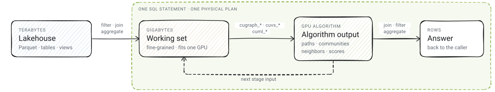

<p align="center">
  
  <br>
  <em>Compose GPU algorithms with SQL.</em><br><br>
  <a href="https://algeon.dev">Website</a> |
  <a href="https://algeon.dev/blog/introducing-algeon">Intro</a> |
  <a href="https://algeon.dev/guides/datasets">Demos</a> |
  <a href="https://algeon.dev/build">Build</a> |
  <a href="https://docs.rs/algeon-datafusion">API Docs</a>
  <br><br>
  <a href="LICENSE"></a>
  
</p>

---

Algeon(`/ˈæl.dʒi.ən/`, pronounced "AL-jee-on") is a GPU query engine that runs graph, vector and machine-learning
algorithms over any relation SQL can produce, inside one statement and on
one GPU. It is built on [Apache DataFusion](https://datafusion.apache.org/):
supported relational plans run on
[cuDF](https://docs.rapids.ai/api/cudf/stable/), and algorithms from
[cuGraph](https://docs.rapids.ai/api/cugraph/stable/),
[cuVS](https://docs.rapids.ai/api/cuvs/stable/) and
[cuML](https://docs.rapids.ai/api/cuml/stable/) are SQL table functions
(UDTFs) whose relation arguments are ordinary subqueries and whose output is
rows the same query can join, filter, aggregate or pass to the next
function. Your application supplies the agent and the domain definitions;
Algeon supplies query execution and the diagnostics beneath it.

## One statement, graph included

Find the foundational papers BERT relies on without citing them directly:

```sql
CREATE OR REPLACE VIEW bert_seed AS
SELECT paper_id AS vertex, CAST(1.0 AS DOUBLE) AS value
FROM papers
WHERE title = 'BERT: Pre-training of Deep Bidirectional Transformers for Language Understanding'
  AND year = 2018;

SELECT p.year, p.title, ROUND(r.value, 6) AS ppr
FROM cugraph_personalized_pagerank(
  edges => (SELECT src, dst FROM citation_edges),
  personalization => (SELECT vertex, value FROM bert_seed)) r
JOIN papers p ON p.paper_id = r.vertex
WHERE NOT EXISTS (SELECT 1 FROM bert_seed s WHERE s.vertex = r.vertex)
  AND NOT EXISTS (SELECT 1 FROM citation_edges e JOIN bert_seed s ON s.vertex = e.src
                  WHERE e.dst = r.vertex)
ORDER BY r.value DESC
LIMIT 5;
```

| year | title | ppr |
| --- | --- | --- |
| 1983 | A Maximum Likelihood Approach to Continuous Speech Recognition | 0.003127 |
| 2003 | A neural probabilistic language model | 0.002984 |
| 1997 | Long short-term memory | 0.002392 |
| 2014 | Adam: A Method for Stochastic Optimization | 0.002358 |
| 1990 | A statistical approach to machine translation | 0.002344 |

The edge list and the seed are subqueries, the 45.6 million citation edges
are read into GPU memory for the statement and released when it finishes,
and the output is rows that a `JOIN` attaches titles to. The
[citation dataset](https://algeon.dev/guides/datasets/citation-network) has
4.9 million papers; the
[example page](https://algeon.dev/cugraph/udtfs/cugraph_personalized_pagerank?dataset=citation-network#examples)
shows the full result.

## Why

A lakehouse holds terabytes, and a question is about one tenant, one quarter
or one cohort. SQL reduces the lake to that working set, and a working set of
that size fits in one GPU's memory, with decoded columns, graph storage and
temporary algorithm memory all counting against it. The questions about it
(which companies form a cluster, which products sit nearest in embedding
space, which rows a model would flag) have mature GPU implementations and no
expression as a join. Each has usually cost an export job and a notebook.
Algeon keeps them inside the query, and a person or an agent writes the next
hypothesis as the next statement.
[Introducing Algeon](https://algeon.dev/blog/introducing-algeon) makes the
case in full.

<p align="center">
  <picture>
    <source media="(prefers-color-scheme: dark)" srcset="website/static/img/algeon-flow-dark.svg">
    
  </picture>
</p>

## Demos

Every example on [algeon.dev](https://algeon.dev/guides/datasets) runs over
a public dataset on one GPU and is published with its SQL, result rows,
query IDs and the binary that produced them. The largest is
[MerRec](https://algeon.dev/guides/datasets/merrec), 1.27 billion Mercari
marketplace events: ranking the brands that moved toward Barbie's audience
takes four graph calls in one statement and
<!-- capture:merrec-scale-barbie-tie-ins.json:median_elapsed_s_after_first:fixed2 -->3.82 s
over Flight SQL, planning included, and a campaign list built from graph
affinity, exact nearest neighbors and a trained model, scored against later
purchases, takes
<!-- capture:merrec-scale-audience-funnel.json:median_elapsed_s_after_first:fixed2 -->20.80 s.
The [citation network](https://algeon.dev/guides/datasets/citation-network),
[Amazon Reviews](https://algeon.dev/guides/datasets/amazon-reviews) and
[EMBER2024](https://algeon.dev/guides/datasets/ember2024) pages apply the
same pattern to research communities, catalog search and malware
classifiers. The
[recorded agent session](https://algeon.dev/guides/gpu-udtf-discovery#6-the-sequence-on-a-recorded-session)
shows the whole loop: list the functions, read one contract, fail twice at
planning time, check GPU coverage, run.

## What is inside

[`cugraph_*`](https://algeon.dev/cugraph) covers traversal, centrality,
community detection, components, similarity, core structure and ForceAtlas2
layout; [`cuvs_*`](https://algeon.dev/cuvs) exact and approximate nearest
neighbors, pairwise distances, per-row top-k, KMeans and PCA;
[`cuml_*`](https://algeon.dev/cuml) query-local TSVD, HDBSCAN, UMAP,
logistic regression and random forests, plus scoring with a pretrained
XGBoost, LightGBM or Treelite forest. Each family's index lists the
installed UDTFs.

The planner owns the physical plan. Supported relational candidates lower to
cuDF, the rest keeps its DataFusion CPU plan, and three
[execution modes](https://algeon.dev/integration/datafusion-session#choose-an-execution-mode)
set how much relational work joins the GPU. `EXPLAIN GPU` reports where a
statement will run before it runs, the
[UDTF catalog](https://algeon.dev/guides/gpu-udtf-discovery) lists,
describes and dry-run validates every installed function, and every failure
Algeon owns carries a stable code, kind and status
([Handling Errors](https://algeon.dev/integration/handling-errors)). Each
query is admitted against a per-device memory ledger and runs inside an
immutable grant on one GPU.

## Run it

Algeon runs on Linux with an NVIDIA GPU and a CUDA toolkit. The four RAPIDS
libraries are built from the pinned submodules before the Rust workspace:

```bash
git clone --recurse-submodules https://github.com/algeon-dev/algeon.git
```

[Build & Test](https://algeon.dev/build) walks through the build shell, the
native builds and the checks. Then start the
[Flight SQL server](https://algeon.dev/integration/flight-sql-server) and
query it from any Arrow Flight SQL client, such as the Python ADBC driver,
or embed Algeon in a
[DataFusion session](https://algeon.dev/integration/datafusion-session) you
already own.

## Status

> [!WARNING]
> Algeon is pre-release. APIs and query behavior change without compatibility
> guarantees, and result verification is incomplete; evaluate it on known
> datasets with trusted reference results.

One query runs on one GPU inside an immutable memory grant and does not
spill; graph construction and algorithm scratch space count toward the
grant. GPU scans read Parquet from local disk or S3-compatible object
storage, and other sources stay on the DataFusion CPU path. Vector indexes,
fitted models and graphs live inside one statement, except that a bounded
server can cache graphs. TPC-H and TPC-DS at scale factor 100 complete on
one GPU with matching row counts
([benchmarks](https://algeon.dev/reference/benchmarks)); there is no
value-level verification of every algorithm's output yet. The
[roadmap](https://algeon.dev/reference/roadmap) lists the order of work, and
the introduction post's
[known gaps](https://algeon.dev/blog/introducing-algeon#known-gaps) the
current limits.

## Built on, contributing and license

Algeon stands on [Apache DataFusion](https://datafusion.apache.org/) and
[NVIDIA RAPIDS](https://rapids.ai/). The cuDF, cuVS and cuGraph sources are
[algeon-dev forks](https://github.com/algeon-dev) pinned as submodules under
`components/`, and cuML is pinned at an upstream revision; `crates/` holds
the DataFusion adapter, the query engine and the Flight SQL server, and
`website/` the documentation and demo captures.
[CONTRIBUTING.md](CONTRIBUTING.md) covers the repository rules and
validation, and checks run locally. Algeon is licensed under
[Apache-2.0](LICENSE).
