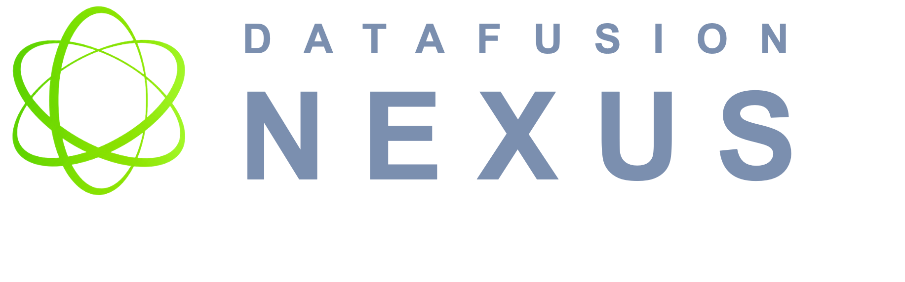

# DataFusion Nexus

[Website](https://datafusion.nexus) |
[Intro](https://datafusion.nexus/blog/introducing-datafusion-nexus) |
[API Docs](https://docs.rs/datafusion-nexus)

DataFusion Nexus is a GPU query engine for [Apache DataFusion](https://datafusion.apache.org/).
It evaluates whole relational physical-plan candidates and selects supported
candidates for GPU execution with [Nvidia cuDF](https://docs.rapids.ai/api/cudf/stable/).
[cuGraph](https://docs.rapids.ai/api/cugraph/stable/) algorithms are explicit
GPU islands callable directly from SQL, and data is read from
[Apache Iceberg](https://iceberg.apache.org/) and Parquet. A relational
candidate that is not selected keeps its executable DataFusion baseline.

Nexus is designed to sit inside your own architecture. Graph workloads are
exposed as ordinary SQL table functions over your existing data, and planning
decisions and errors are returned as structured, machine-readable values — so
both application code and agents can reason about a query before and after it
runs.

## Features

- **GPU SQL execution.** Nexus selects an entire supported relational physical
  candidate for cuDF execution. `not_supported` and `not_selected_by_cost` are
  planning diagnostics; they leave an otherwise valid executable DataFusion
  plan intact. A caller that requires no DataFusion CPU execution adds a
  final-plan requirement instead.
- **Graph algorithms in SQL.** The `cugraph_*` table functions (PageRank, BFS,
  Louvain, ForceAtlas2, and more) run cuGraph over an edge table or view and
  return ordinary rows, so a graph traversal, a join, and an aggregation can
  live in one query over the same data — no separate graph database and no copy
  to keep in sync.
- **Vector search and vector ML _(in progress)_.** The next accelerator on the
  same pattern is [cuVS](https://github.com/NVIDIA/cuvs): `cuvs_*` table
  functions for GPU nearest-neighbor search and vector workloads such as
  clustering and dimensionality reduction, callable from SQL over your existing
  tables.
- **Lakehouse data access.** Query Iceberg tables from REST catalogs, AWS Glue,
  or S3-compatible object stores, with KvikIO streaming Parquet from object
  storage directly into GPU memory. The unified Iceberg scan shares resolved
  facts with its executable CPU delegate; remote catalogs remain read-only, and
  views and scratch tables can live in an opt-in mutable local workspace overlay.
- **Explainable planning.** Planning reports record relational candidate
  outcomes and the exact completed-plan disposition. `nexus_explain_coverage('<sql>')`
  returns that evidence as machine-readable JSON before a query runs, and errors
  cross the DataFusion boundary as typed values with stable identity rather than
  log text — a surface application code and agents can consume directly.
- **Bounded GPU memory.** Bounded mode plans each query against a GPU memory
  budget: shapes without a provable memory contract are rejected at planning
  time, admitted queries receive their reservation before execution, and runtime
  pressure is absorbed by chunk-split retries. A query that exhausts its retries
  fails with structured facts rather than an opaque OOM.
